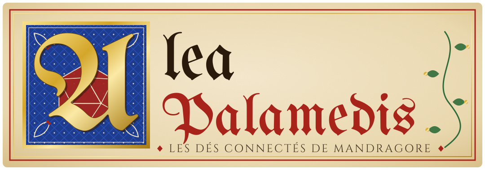
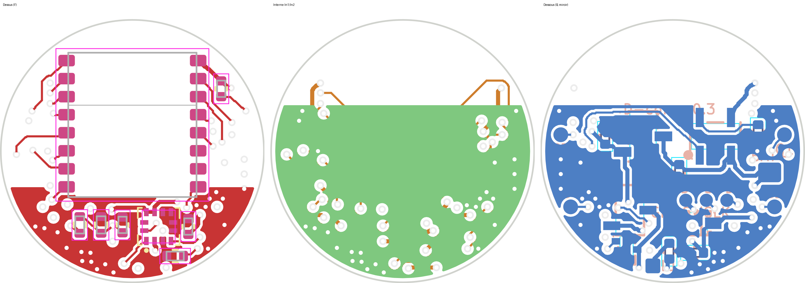
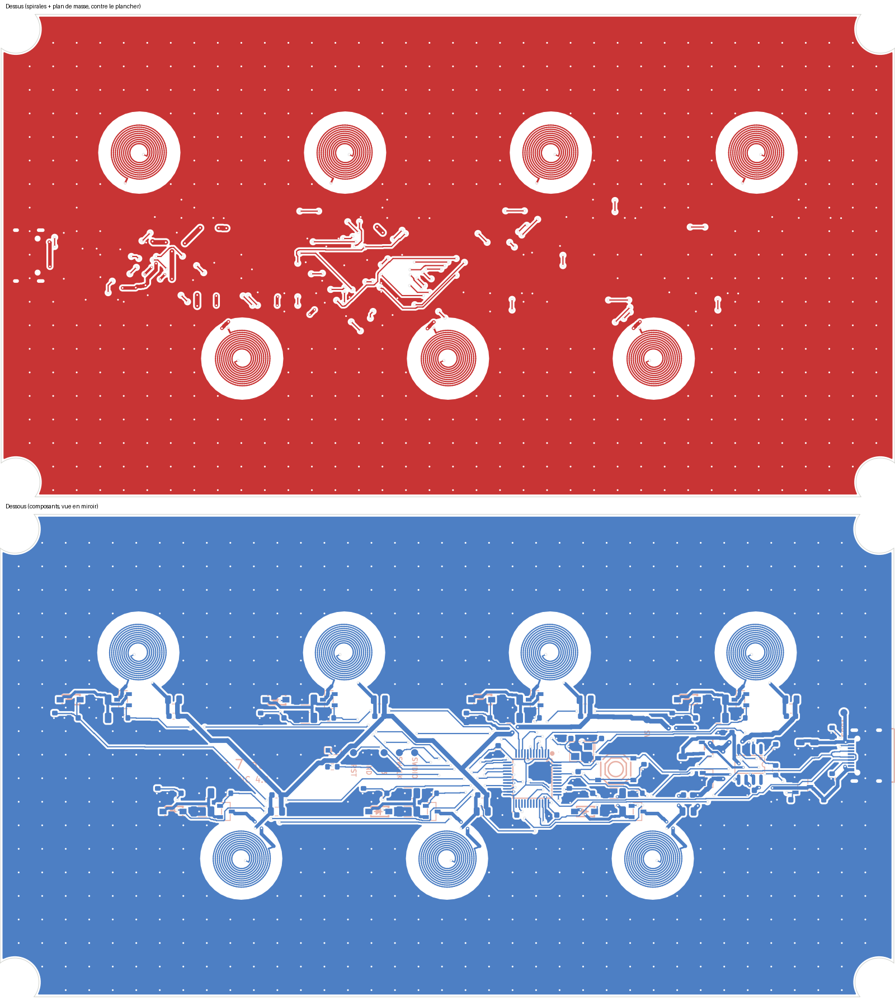

# Alea Palamedis — dés connectés pour Mandragore

**[Mandragore.ai](https://mandragore.ai/) · [Maitresinh@500nuancesdegeek.fr](mailto:Maitresinh@500nuancesdegeek.fr)**

**Licences :** firmware et logiciels sous **AGPL-3.0**, matériel sous **CERN-OHL-S-2.0**, logo et documentation sous **CC BY-SA 4.0**. Citation et partage à l'identique obligatoires ; licence commerciale sur demande pour qui ne veut pas publier ses modifications. Détails : [LICENCES.md](LICENCES.md).

**Mandragore.ai · 23 novembre 2026 · prototype : conçu et simulé, pas encore fabriqué**

Selon la légende, Palamède a inventé les dés pendant le siège de Troie, puis les a consacrés à Tyché, déesse du hasard. *Alea Palamedis*, ce sont ses dés, avec du Bluetooth.

Chaque dé connaît la face sur laquelle il s'arrête et l'annonce par Bluetooth au **Mentor** (aide au MJ pendant la partie de jeu de rôle) et au **Sage en direct** (jeux de plateau). Le Mentor reçoit le jet comme un fait, sans devoir le deviner dans la parole, et le relie à l'action déclenchée et à la fiche du personnage. Le dé peut aussi signaler sa valeur à une tablette ou à un plateau à l'encre conductrice par des pastilles capacitives invisibles, cachées sous la peinture.

## Principe

- **Pas de circuit souple ni de moulage délicat** : un petit cœur rond (Ø16 mm) est noyé dans la résine, à l'intérieur d'une coque imprimée en deux parties qui sert de moule. Le dé final est plein et équilibré.
- **Électronique** : module Bluetooth Fanstel BC832 (nRF52832), accéléromètre LIS2DH12, pile bouton rechargeable LIR1254, recharge sans fil.
- **Recharge** : une boîte recharge les 7 dés d'un set. Une bobine gravée dans le circuit imprimé se trouve sous chaque logement ; chaque emplacement détecte le dé posé et s'arrête seul.
- **Premier dé : D20.** Le D4 est un D8 numéroté deux fois de 1 à 4. Les coques D6, D8, D10 et D12 restent à dessiner.

## Contenu du dépôt

| Dossier | Contenu | État |
|---|---|---|
| [`materiel/coeur`](materiel/coeur) | cœur du dé v0.3 : paquet de commande JLCPCB (Gerbers, nomenclature, placement), projet KiCad | contrôle de conception sans erreur |
| [`materiel/chargeur`](materiel/chargeur) | carte émettrice de la boîte v0.1 : paquet JLCPCB, projet KiCad | contrôle de conception sans erreur |
| [`coques`](coques) | coque D20 en deux parties (STL), patron A4 des pastilles, notice de montage | à imprimer |
| [`boite`](boite) | boîte-chargeur 7 dés (STL) et sa notice | à imprimer |
| [`firmware`](firmware) | firmware du dé (nRF52) et du chargeur (CH32V203), binaires, variante de carte | compilé, pas encore essayé sur le matériel |
| [`logiciel`](logiciel) | client Web Bluetooth (TypeScript), journal des jets pour le Mentor, module Tabletop Kit, note d'intégration Mandragore | types vérifiés |
| [`simulations`](simulations) | pastilles capacitives (BEM), recharge sans fil (SPICE, Monte-Carlo), résultats | voir ci-dessous |
| [`scripts`](scripts) | génération des circuits (KiCad / pcbnew), routeur, coques et boîte (trimesh) | — |

## Ce qui a été simulé

- **Pastilles capacitives** (simulation électrostatique) : avec 4 groupes de pastilles dispersés sur les faces, le signal garde 76 à 84 % de celui d'une pastille indépendante par face. Sur une tablette, il atteint environ 36 à 46 % du signal d'un doigt.
- **Recharge sans fil** : la tension reçue dans le dé reste entre 5,0 et 5,7 V pour un écart de 1,5 à 2,5 mm et un décentrage jusqu'à 1,5 mm, tolérances des composants comprises (Monte-Carlo). Pile pleine, le dé court-circuite sa bobine pour ne rien chauffer.

## À valider sur le premier prototype

1. Mesurer la tension de recharge reçue dans le dé et le seuil de détection du chargeur.
2. Faire une mise à jour Bluetooth complète **avant** de couler la résine.
3. Vérifier l'équité du dé : 500 lancers et un test du χ².

Vous poursuivez ce travail ? Envoyez-nous vos mesures et vos améliorations, ou ouvrez une issue / pull request.
